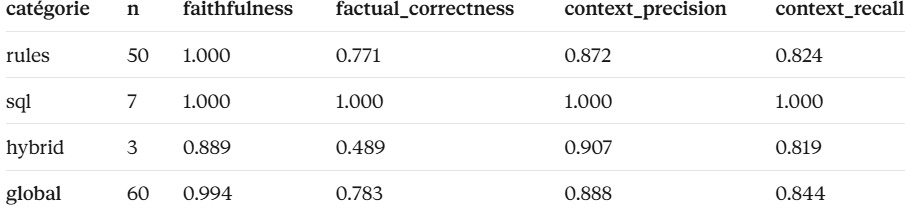
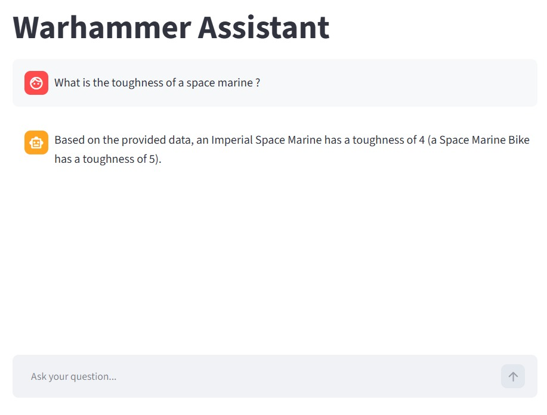
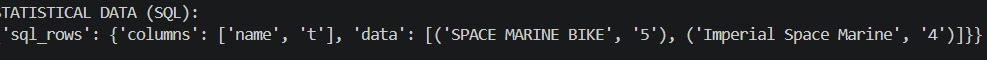

# The Warhammer Expert tool 
## Overview 
This app allows the user to converse with a LLM and to ask precise questions about Warhammer, about its rules or specific information related to the units and overall gameplay. It uses a RAG pipeline to add parts of documents to the context of a LLM query.
## The Pipeline 
### Information Sources
#### Warhammer Rules
The main source for the RAG is a pdf containing the comprehensive set of rules of the game Warhammer. For the document to be used for RAG, it was parsed using the DocumentConverter from docling and transformed into a markdown file. This solution is quite heavy on compute, but fits our case because our number of documents is relativelly small so we can trade a bit of speed for accuracy [parsing](domain/parsers/pdf_parser.py).
#### Units Database 
The second source of information the llm will have to pick from is a database containing information about elements of the game. We use Sqlite to store and interact with it. You can go through its architecture in the [database_dictionnary](database/doc/SQL_AGENT_DATA_DICTIONARY.md).
### Chunking
Because our Rules text is a md file, chunking is relatively easy. We chose to use section chunking (we impose that a chunk is contained in only one section of the file). A problem that we encountered is that our chunk length is relatively small, so in order to answer very broad questions, the llm has to retrieve many relevant chunks the problem is that our number of ranked chunks (after the reranker) is fixed so in some cases the llm misses some information. A possible fix would be to try to infer the number of chunsks needed based on the user input.
 You can have more information in [chunking](domain/text_processing/doc.MD)
### Chunk Storage and Retrieval
In order to store then retrieve the chunks, we use a vector database. We chose to implement with chromaDB. The vector database is created and populated at the start of the app. Altough it is stored on disk, so further app calls won't create the database and just use the previous one. For more details see [vector_db_doc](infra/databases/vector_db.md).
### Reranker 
The reranker allows to thin our selected chunks pools by applying a more compute heavy model to compare the query and the retrieved chunks. For more details [reranker_doc](domain/reranker/reranker_doc.md).
### Text to SQL 
In order to retrieve information from the database, we simply call a LLM (gemini-3.5-flash) to construct a relevant sql query based on the user input. The LLM has access at the database structure through its dictionnary added to the system prompt. Finally we also use few fixed examples for the few shot sql, this has good performances. But we could have also implemented dynamic example retrieval, where the examples used in the prompt are actually selected based on the prompt of the user rather then being fixed. 
>Note: The database is read only
### Execution Graph 
Our RAG graph is done via Langgraph which implements execution graphs which propagates states. One go through the graph is a single round of conversation between the user and the llm (user query and llm answer). So in order to keep the conversationnal nature of the interaction, we use a checkpointer associated with tread id, this allows to keep the conversation history for further user prompts. For now, the system always retrieves something and does it based only on the last message in the conversation this brings two issues: 
- the last message may not reference directly information in the sources (ex: what about the next?) but need some additional context. Fix: rather then putting only the last one, maybe mix the last message with older context.
- A message may not necessitate to gather information (we suppose that the first always does, but the second may be a question which still be answered based on the retrieved context) Fix: Condition the retrieval and add a no retrieval generation but with the previous messages.
The LLM which is used for the conversation is gemini-3.5-flash. It is relatively lightweight.

## Running the app 
Important: install uv (pip install make) and make. 
Run:  make app 
Test: make tests 
## Test Results 
### Dataset generation 
For details on how the datasets were generated see [eval_dataset_doc](evaluation/ragas/retrieval_evaluation.md)
### Retrieval 
Overall our retrieval tests were very satisfactory. We tested with various sets of chunk_sizes and top_ks (size of the chunks and number of retrieved chunks). We found that unsurprisingly the most impactful setting is the number of retrieved chunks, moreover we see that past a cetrain value (5 in our case) recall stops improving. (the low impact of chunk size maybe due to the fact that the questions tested require a low amount of information, <300 tokens so having a longer texter doesn't really affect the performance)
### RAGAS 
In order to test the performances of our entire pipeline, we used RAGAS which allows to use an llm to evaluate the answer of another llm to a query. We tested for 4 metrics. Here are the results.
 
 > Note: We started the RAGAS with gemini but ran out of credits midway, in order to finish the run we used Claude sonnet 5.5.
### Miscellaneous
During ou testing we tested with this question Q1:"What is the toughness of a space marine ?". This question obviously needs a sql query and no rules. Here is our result:

And here is the query:
 
We can see that actually, the llm fetches two units, this is because it checks if "space_marine" is IN the unit names. 
(dynamic sql envisagé, contexte faible trois chunks nécéssité de rag fusion)